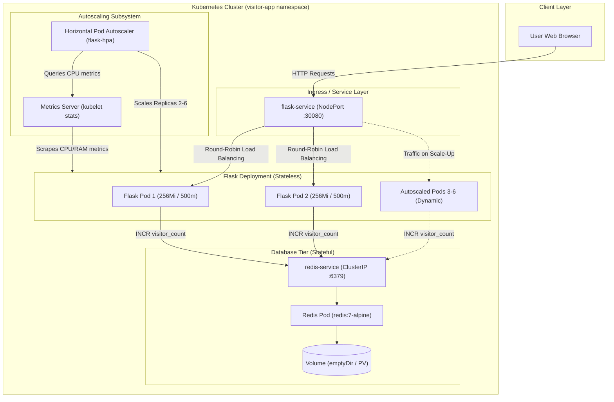

# System Architecture & Technical Design

## 1. High-Level Architecture

The Visitor Counter application is designed as a cloud-native, containerized microservice running on Kubernetes with an in-memory Redis database.



---

## 2. Hybrid Cloud & Failover Architecture

For Task 4, the application architecture demonstrates dual-environment resilience across two isolated cluster profiles or namespaces:

```mermaid
flowchart LR
    Client["Traffic Ingress / Gateway"]

    subgraph PrivateEnv["Private On-Premise Cluster (:30081)"]
        PrivFlask["Flask Deployment (2 Replicas)"]
        PrivRedis["Redis Stateful Backend"]
        PrivFlask --> PrivRedis
    end

    subgraph PublicEnv["Simulated Public Cloud Cluster (:30082)"]
        PubFlask["Flask Deployment (2 Replicas)"]
        PubRedis["Redis Stateful Backend"]
        PubFlask --> PubRedis
    end

    Client -->|Primary Traffic (Normal State)| PrivateEnv
    Client -.->|Failover Traffic (On Outage)| PublicEnv
```

### Failover Mechanics
1. **Primary Active:** User traffic is routed to the Private Cluster running on local port `30081`.
2. **Failure Injection:** Simulating private outage by scaling replicas to 0 or stopping private cluster services.
3. **Automated Redirection:** Traffic switches instantly to the Simulated Public Cloud Cluster (`30082`), ensuring zero application downtime.
